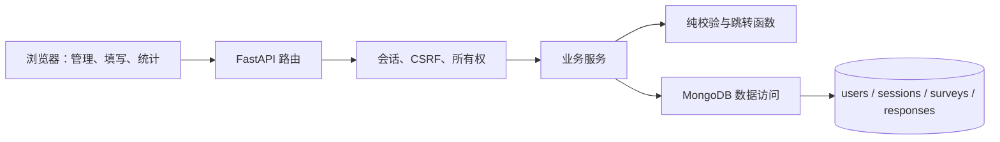

# 系统设计说明

> 第一阶段正式文档。2026-10-22完整测试为200项通过、0失败、0跳过；复测方法、历史结果及证据范围见[测试说明](tests.md)和[关键验证证据](evidence/README.md)。

## 系统目标和部署

建立基于 MongoDB 的简化在线问卷系统。采用 Python、FastAPI 同步路由、同步 PyMongo、Jinja 模板与原生 HTML/CSS/JavaScript。同源页面通过 JSON API 操作 MongoDB；浏览器显示只负责交互，授权、状态、校验和最终路径由后端判定。实际模块与锁定依赖已存在于app/、pyproject.toml及requirements.lock，新环境复现通过。

## 模块职责

| 职责 | 输入与输出 | 约束 |
| --- | --- | --- |
| 认证会话 | 用户凭证→安全用户、会话 Cookie | 哈希保存密码及令牌；退出删除会话；到期主动检查 |
| 问卷管理 | 草稿及 revision→保存定义/冲突 | 所有权、稳定 ID、草稿条件更新、发布冻结 |
| 定义和答案校验 | 题型、配置、答案→规范值或定位错误 | 正下限执行、未知字段拒绝、精确数字、零值有效 |
| 跳转 | 有序定义与答案→路径 | 按序首条命中；合法空答默认下一题；防损坏循环 |
| 答卷提交 | 版本、幂等键、匿名选项、答案→回执 | 服务端重放、最终准入、单文档插入和唯一索引 |
| 统计 | 所有者、问卷/题目→计数及内容 | 动态读取成功答卷；份数和独立人数区分 |
| 存储适配 | 旧 BSON→内部模型 | 缺可选字段使用兼容默认值；不把旧文档当新请求直接验证 |

## 认证与权限边界

用户只能管理自己的问卷和统计；分享链接上的已登录他人可以填写已发布问卷，不能误把管理所有权检查用于填写。服务端从会话取得 userId，禁止客户端指定 ownerId、respondentKey、repeatMode 等内部字段。

身份 Cookie 使用 HttpOnly、SameSite=Lax；CSRF 原令牌放独立同源 Cookie，写请求携带 X-CSRF-Token 并检查 Origin。会话库保存两个令牌的摘要；TTL 负责清理，业务请求仍检查 expiresAt。登录后跨页或刷新仍可读取 CSRF Cookie，不能从数据库摘要反推原令牌。

## 生命周期与一致性

草稿可修改；发布先验证定义并冻结 v1；关闭和截止使新提交不可准入。截止用 UTC 保存，北京时间显示，now>=closesAt 拒绝新提交。修改和发布按 _id、ownerId、status、revision 条件单文档更新，冲突不能静默覆盖。

一份成功答卷以一个 responses 文档写入。问卷关闭与答卷插入不承诺跨集合原子性：最终准入检查已通过的在途请求可以完成，关闭后新准入被拒绝。记录 admittedAt 和 submittedAt 供复核。当前不以部署事务副本集为第一阶段前置条件。

## 提交数据流

1. 严格解析请求并验证会话、Origin、CSRF。
2. 取得问卷及请求声明的 definitionVersion，加载对应定义，不回落到最新版。
3. 按该定义规范化答案和匿名选择，计算包含版本的 payloadHash，并先按历史定义重放路径、拒绝路径外显式空答。此校验不检查当前是否接受新提交。
4. 查成功幂等记录；同键同内容返回原回执，同键不同内容冲突。
5. 只对新提交检查版本是否接收、状态、截止和匿名开关；答案校验仍以此前加载的对应历史定义为准。
6. 最终准入后插入单一完整答卷；唯一索引竞争结果转换为幂等回执或重复冲突。
7. 统计下次读取反映成功保存，不维护易失真手工计数器。

## 第一周扩展结构与第二周演进

题型与运算符使用小型函数注册表；问卷读取统一通过 load_definition(surveyId, definitionVersion)；版本1为冻结定义；外部请求严格、内部存储兼容读取。schemaVersion 表示 BSON 结构、definitionVersion 表示题目与规则业务版本、revision 表示草稿编辑次数，三者不可混用。

新增题型扩展处理器、请求模型、编辑和填写渲染以及统计；新增运算符扩展匹配和定义校验，不在主遍历代码写专用分支。第二阶段若开放发布后改题，先保存 v1 历史定义，再创建新版；旧答案始终按旧题目和选项解释。

E01–E04 演练见 tests.md。迁移先备份、dry-run、隔离库验证，再按版本执行；记录处理数和核对结果，重复执行不能重复转换，不得清库或重做原系统。

## 当前实现核对表

| 事项 | 代码位置 | 运行证据 |
| --- | --- | --- |
| 路由、业务、数据访问实际划分 | app/api、app/services、app/repositories | 已核对；认证/管理/API实际断言通过 |
| 同步路由与 PyMongo 调用 | app/main.py、app/api/*.py、app/database.py | 已核对；认证/管理/API实际断言通过 |
| 题型、运算符与统计注册 | question_types.py、rule_operators.py、statistics_service.py | E02及四题型/统计处理器实际回归通过 |
| 版本读取与存储兼容 | definition_service.load_definition、storage_adapters.with_storage_defaults | E03/E04实际回归通过 |
| 校验、提交、统计数据流 | answer_validator.py、jump_engine.py、response_service.py、statistics_service.py | 对应自动断言及浏览器流程通过 |

统计入口通过 STATISTICS_HANDLERS/register_statistics_handler 分派；四种正式题型共用标准聚合处理器，新增题型可以注册自己的处理器。发布前检查题型已有统计处理器。初始化入口为 app.database.initialize_database，scripts/init_db.py 调用同一函数；scripts/setup.py 仅在缺失时生成本地 .env，保留原密钥。

## 统计请求一致性和处理器签名

实际统计先固定该请求读到的不可变response ID成员列表，totals、每题聚合、分页及精确均值共用response_filter。后续插入只进入下一次查询，避免同一次响应总份数、选项、内容和均值混用不同集合；不宣称单实例获得跨查询事务快照。统计处理器签名为handler(db,survey,question,submission_count,page,page_size,response_filter)，新增处理器必须沿用筛选条件。

ID集合内存O(n)；筛选条件BSON超过15MiB时返回503/STATISTICS_TOO_LARGE，为MongoDB16MiB命令边界留余量。当前课程规模使用该明确取舍；更大规模应评估副本集快照或分批归并。本次并发插入边界有4项真实库回归，实际输出见test-results.json。

## 本轮独立复核后的生产契约

from_storage_survey已真实接入所有者读取、定义读取、提交当前及最终准入、问卷DTO等生产路径。只为缺失的已知可选字段提供description=""、allowAnonymous=false、allowMultipleSubmissions=false、closesAt=null；返回深拷贝，GET或提交不暗中改写旧问卷。未知未来字段和缺核心字段不能自动猜测，仍需显式默认值或迁移。

统计翻页更新整个题卡和summary中的对应题目，包括回答数、人数、未答数、平均、内容与分页；范围切换保留已刷新题卡。整卷摘要保持上次整卷查询快照，页面显示整卷/本题更新时间并提供整卷刷新；这不是WebSocket实时推送。generation标记避免较早请求覆盖新的整卷结果。

题ID视为稳定的不透明字符串，普通Unicode、斜线和百分号保持原值。前端encodeURIComponent一次，后端使用path参数并由框架正常解码，不对业务ID额外unquote。保留END以及不能正确寻址的.、..、Unicode Cc控制字符和Cs代理字符作为非法ID，保存前422且不部分写入；all仍是合法题ID，界面用空串表示整卷范围。截止时间UTC转换也在错误边界内处理，年份转换溢出返回422/INVALID_DEADLINE。

本机保留原标签stage1-v1.0（a74cf92）、修订标签stage1-v1.0.1及原BSON归档。公开版本仅包含当前筛选后的代码与材料；补证及扩展边界见[实验报告](report.md)。
