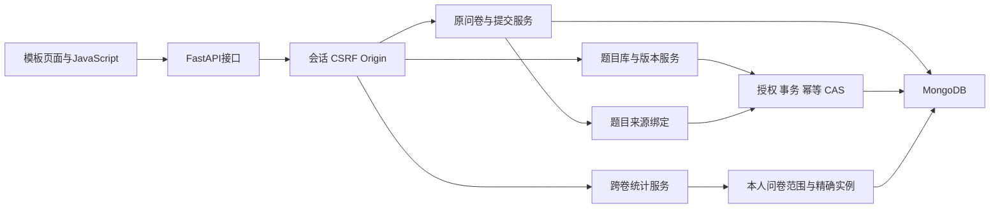

# 第二阶段系统架构

第二阶段继续使用Python 3.12、FastAPI同步路由、同步PyMongo、Jinja模板与原生JavaScript。第一阶段的账号、问卷生命周期、四种题型、路径重放、答案存储和单卷统计继续运行，在其上增加独立题目、版本、授权、个人收藏、来源绑定和跨卷汇总。所有业务持久化数据仍保存在MongoDB，未引入关系数据库、成品问卷框架或第二套填写引擎。

## 模块及请求路径

| 层次 | 代码 | 职责 |
| --- | --- | --- |
| 原接口及页面 | `app/api/auth.py`、`surveys.py`、`participation.py`、`statistics.py`，原模板和静态脚本 | 保持第一阶段操作；问卷管理DTO增加来源，填写DTO不暴露内部授权 |
| 题库API | `app/api/library.py`、`library_instances.py`、`library_statistics.py` | 严格请求结构、会话身份、明确版本和revision，统一错误返回 |
| 原业务 | `survey_service.py`、`response_service.py`、`definition_service.py`、`jump_engine.py`、`question_types.py` | 问卷冻结、历史定义、旧提交幂等和路径/答案校验 |
| 题目与权限 | `library_service.py` | 编辑稿、不可变版本、恢复、派生、共享、公共维护、版本下架、收藏、使用计数、事务和回执 |
| 来源适配 | `question_reference_service.py` | 选用、快照生成、实例升级、原PATCH防篡改、usage、发布锁定、快照批量派生 |
| 跨卷汇总 | `statistics_scope.py`、`cross_survey_statistics.py` | 单独确定可统计问卷范围，按精确版本/实例聚合，不增加他人答卷权限 |
| 数据初始化 | `app/database.py`、`library_database.py` | 幂等维护集合验证器及索引，不在普通启动时迁移全库 |
| 运行与升级 | `deploy/stage2.compose.yaml`、`scripts/migrate_stage2.py`、`verify_stage2_upgrade.py`、`manage_admin.py` | 独立事务环境、显式迁移、旧BSON核对和受控管理员授予 |
| 新界面 | `library.html`、`library.js`、`library.css`，原editor扩展 | 四题型表单、历史、共享、标签、来源、明确选用和汇总展示 |

## 两条读取路径

**填写路径**仍读取问卷中的完整快照。实例包含标题、题型、选项、校验和当前问卷的跳转；不需要逐题读取源题、最新版本、授权或题库。源题更新、下架、归档和撤权不会使已发布问卷变成空题。

**管理路径**读取独立题目及其版本，检查owner或公共维护角色/有效授权。选题时读取指定正式版本并固化快照，同时保留来源引用；不是只复制文字，也不通过最新指针动态渲染旧问卷。

这两条路径使独立版本管理不强迫填写流程增加多次关联。搜索和题库管理仍有批量状态/权限查询，课程规模内采用有界列表和索引；不宣称所有管理页始终只有一次数据库查询。

## 内容身份与可变记录

独立题目拥有questionId，正式版本拥有questionVersionId，问卷中的每次出现沿用原实例ID。rootQuestionId只记录来源家族；共享挂在独立题目上，不沿根向所有派生题传播。

题目管理记录中的workingContent可以在未曾发布使用时原地保存。正式版本只插入，内容不覆盖。“保存编辑稿”与“保存为新版本”是两个后端动作；后者与管理指针、版本状态和幂等回执同事务。发布问卷时永久设置hasPublishedUsage，之后普通稿覆盖被拒绝，内容修改只能随新版本提交。

schemaVersion表示存储结构，definitionVersion表示问卷业务定义，versionNumber表示独立题目内容版本，revision表示某条可变记录的并发状态。四者不互相替代。补来源元数据不会把旧答卷改成新业务版本。

## 权限入口和并发边界

登录会话给出actor，写接口继续检查Origin和CSRF。题目来源可见性、选用资格、原题维护、本人问卷管理、使用计数和答卷统计分别检查。管理员维护公共题，不因此读取所有私有问卷。个人标签写自己的bookmark，不改变源题或他人分类。

普通内容写入使用预期revision。跨文档写入使用实际MongoDB事务；不在用户打开编辑页面后长期占锁。选用需要真实更新题目、版本状态及必要共享授权的guard，归档、下架或撤权写同一控制记录，避免“事务里先读授权再只写问卷”的竞争漏洞。

发布和普通编辑稿保存也在同一题目记录竞争：发布设置hasPublishedUsage并推进管理revision；普通保存匹配false和预期revision。多题发布按稳定题目ID顺序处理。失败回滚不消耗内容版本号，不产生孤儿版本或成功回执。

## 统计路径

独立 `resolve_statistics_scope` 首版只返回本人问卷。统计根据questionRefs查找精确 `(surveyId, definitionVersion, instanceId)`，固定本次答卷ID成员后聚合回答数、答卷数、问卷数、选项和数值分布。数值高精度流式求和后统一除法，文本只返回次数和不同内容数。

同卷两实例产生两条回答但只是一份答卷；逐卷按稳定respondentKey去重填写账号。匿名也需登录，同卷可去重，跨卷键不同，因此无全局去重人数。源题撤权后，用户仍可统计本人合法持有快照的回答。

维护者的他人历史使用N只查询usage并经过独立维护权限，不读取答案，不扩展统计scope。跨卷不提供合并答卷明细或导出，原单卷查看填写内容的能力继续保留。

## 部署和演进范围

原课程共享MongoDB保留在27017；第二阶段独立实例位于27018、`survey-rs`，使用独立持久卷。已在真实副本集验证事务提交与回滚。本机单节点副本集提供事务能力，不作为高可用部署证明。

旧数据先恢复到预览库，再显式登记来源及使用关系；已验证原9用户、33答卷BSON逐条不变，8问卷原内容/实例/规则及统计不变。正式切换和最终浏览器/全量结果在实施状态与迁移记录中补充，不能用早期预览副本替代停写后的最终快照。

新增题型仍须同时提供内容校验、答案处理、编辑/填写与统计能力。未来可扩展scope规则或容器共享，但必须补授权、数据映射和回归，不假称换一个字段即可自动安全开放。
